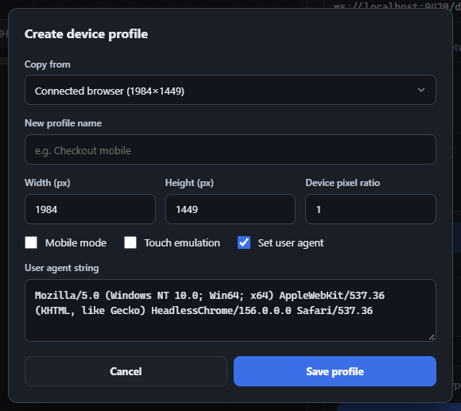

Beyond the built-in iPhone/iPad/Pixel/Desktop presets, you can create unlimited custom device profiles. Click **Create Profile** (or **Edit Profile**, enabled once at least one custom profile exists) to open the device profile dialog.

-   **Copy from** seeds every field from an existing profile - including the special **"Connected browser"** entry, which reflects the *real, live* dimensions, pixel ratio, user agent, and touch/mobile capability of whatever page is currently attached (refreshed automatically on connect, on navigation, and after applying/clearing emulation).
-   **Width / Height / Device pixel ratio** - numeric fields with sane bounds (1–10,000,000px, 0.1–10 DPR).
-   **Mobile mode / Touch emulation** - independent checkboxes.
-   **Set user agent** - when checked, reveals a required text field for a custom UA string; unchecked, the page's real UA is left alone.
-   Profile names must be unique (case-insensitive) against both built-ins and your other custom profiles, up to 80 characters.
-   **Delete** is only available while editing an existing custom profile (never for built-ins or "Connected browser").

Applying a profile sends `Emulation.setDeviceMetricsOverride`, `Emulation.setTouchEmulationEnabled`, and (if set) `Emulation.setUserAgentOverride` together; Clear reverses all three. Custom profiles are saved via `chrome.storage.local` and sync live across every open inspector panel window.

<figure class="doc-screenshot">

<figcaption>Creating a profile, pre-filled from "Connected browser" - the live page's actual size, DPR, and user agent.</figcaption>
</figure>
