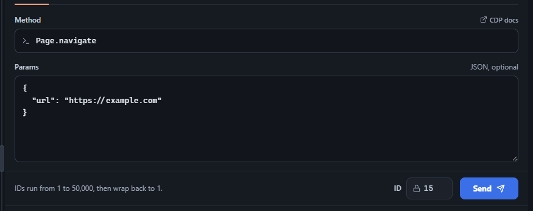
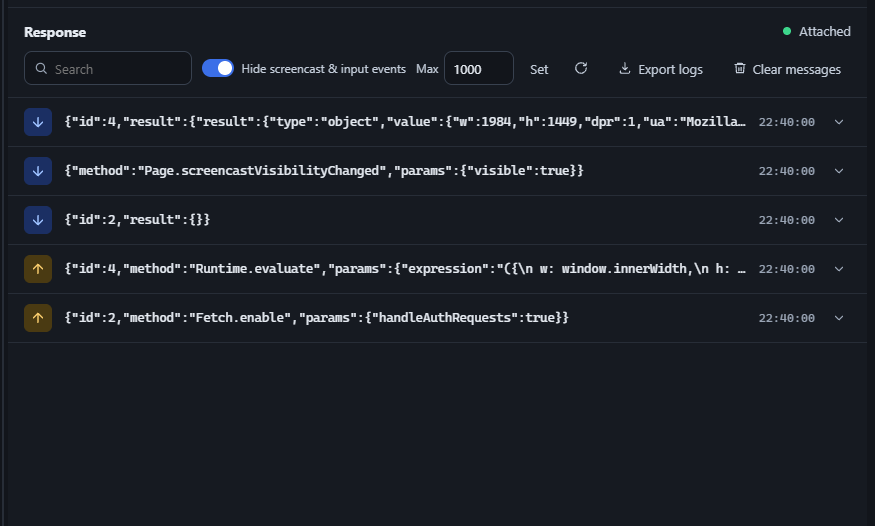

The Message tab is a raw CDP command sender with full autocomplete over every method in the protocol. Type a domain and method (e.g. `Page.navigate`), and the Method field suggests matches with their domain and a deprecation badge where relevant; selecting one pre-fills the Params box with a skeleton of its required parameters. A "CDP docs" link jumps to that exact method's page in the official protocol reference.

<figure class="doc-screenshot">

<figcaption>Composing a command: method autocomplete and JSON params, ready to send.</figcaption>
</figure>

Every command sent and every event received is logged below, color-coded by direction (sent vs. received) and outcome (ok vs. error). Rows expand to show the full raw JSON, and the log supports search, a configurable retention limit, and exporting the whole history to a JSON file (**Export logs**). Screencast frames and raw input events are hidden from the log by default (toggle) to keep it readable.

<figure class="doc-screenshot">

<figcaption>The response log - sent commands (orange, up arrow) and received events/responses (blue, down arrow).</figcaption>
</figure>
