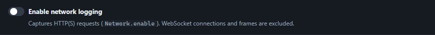
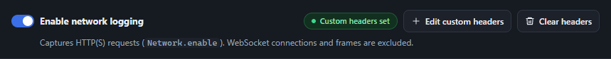
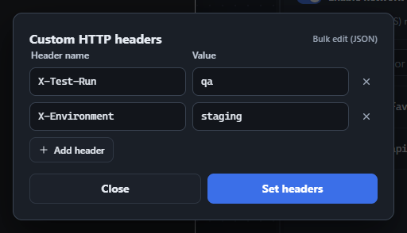
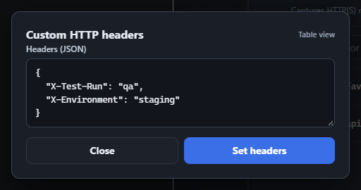
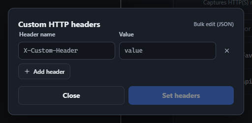
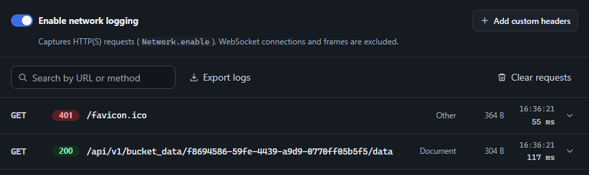
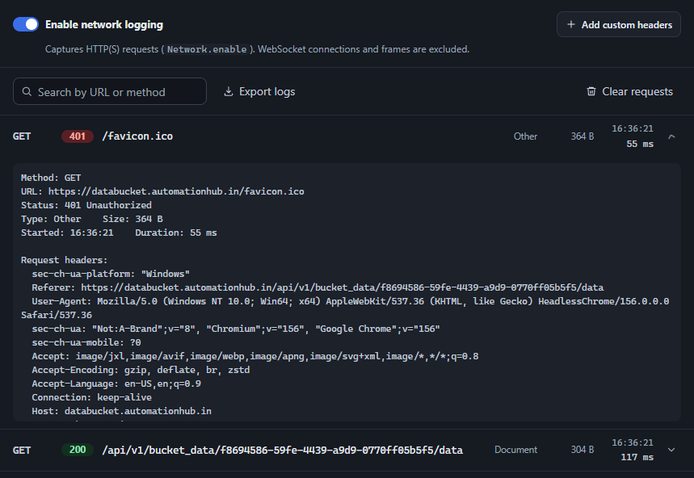

The Network tab captures every HTTP(S) request the attached page makes and shows it as a row - method, status, endpoint, resource type, size, start time, and duration - built live from CDP's `Network.requestWillBeSent`, `responseReceived`, `loadingFinished`, and `loadingFailed` events. **WebSocket connections and frames are deliberately excluded** - this tab is for REST/API/asset traffic.

Logging is off by default. Flip the switch at the top to send `Network.enable` and start capturing; flipping it off sends `Network.disable` and marks any still-in-flight request as canceled rather than leaving it stuck "pending" forever.

<figure class="doc-screenshot">

<figcaption>Logging disabled - the custom header controls appear after enabling network logging. Existing captured requests remain available.</figcaption>
</figure>

<span class="legacy-anchor" id="custom-headers"></span>

## Custom HTTP headers

Custom headers are managed in the **Network** tab. Once network logging is enabled, **Add custom headers** opens the editor. Click **Set headers** to apply extra headers to subsequent requests through `Network.setExtraHTTPHeaders`.

1.  Turn on **Enable network logging**, then click **Add custom headers**.
2.  In table view, enter a **Header name** and **Value**. Use **Add header** for more rows or the remove button to delete a row. Blank names are ignored.
3.  For bulk editing, choose **Bulk edit (JSON)** and enter a JSON object of header name/value pairs. Use string values for HTTP headers. Invalid JSON, arrays, and other non-object values show a validation error. Choose **Table view** to convert a valid object back into rows.
4.  Click **Set headers**. The toolbar shows **Custom headers set**, the editor button becomes **Edit custom headers**, and **Clear headers** becomes available for a non-empty header set.
5.  Close the dialog and trigger a new request to inspect its headers in the request list below. Existing requests are not changed retroactively.

<figure class="doc-screenshot">

<figcaption>After Set headers - the Network toolbar shows the active indicator, Edit custom headers, and Clear headers.</figcaption>
</figure>

```json
{
  "X-Test-Run": "qa",
  "X-Environment": "staging"
}
```

<figure class="doc-screenshot">

<figcaption>Table view - add, edit, or remove header rows, then click Set headers.</figcaption>
</figure>

<figure class="doc-screenshot">

<figcaption>Bulk edit (JSON) - edit the same headers as a JSON object, or return to Table view.</figcaption>
</figure>

**Close** or Escape closes the dialog while retaining its mode and in-progress table/JSON edits for the open inspector page. Closing does not apply edits or remove headers already set. Switching back to table view with invalid or empty JSON leaves the previous table rows intact.

To remove custom headers, close the dialog and click **Clear headers** in the Network toolbar. This sends an empty header set, removes the active indicator, and changes the button back to **Add custom headers**. It also clears both editor drafts: reopening starts in table view with one blank row, no previous JSON values, and Set headers disabled until valid headers are entered.

<figure class="doc-screenshot">

<figcaption>After Clear headers - Add custom headers opens a fresh table with one blank row. The JSON draft is empty too.</figcaption>
</figure>

:::note
**Clear requests** only empties the captured request list. Use **Clear headers** to remove custom HTTP headers and reset the editor. Removing a row alone does not update the browser until you click **Set headers**.
:::

## The request list

Once enabled, requests appear newest-first as they happen. The row shows the endpoint (path and query string) rather than the full URL, since every request to the same host would otherwise be indistinguishable - hover a row, or expand it, to see the full absolute URL. Use the search box to filter by URL or method, **Export logs** to save the captured list as JSON, and **Clear requests** to empty it.

<figure class="doc-screenshot">

<figcaption>Live captured requests - an API document and a favicon request, with Add custom headers above the list.</figcaption>
</figure>

## Request detail

Click any row to expand it and see the full URL, status, timing, and complete request/response headers - including headers only available via CDP's `*ExtraInfo` events (like the real `Cookie`/`Set-Cookie` values, which are often missing from the base events). Scroll within the expanded details to inspect the remaining header lines.

<figure class="doc-screenshot">

<figcaption>Expanded request - full URL, status, timing, and scrollable request/response header details from the live session.</figcaption>
</figure>

:::note
Redirects are tracked too - if a request hops through one or more redirects before landing on its final response, each hop's status and URL is recorded and shown in the expanded detail.
:::
