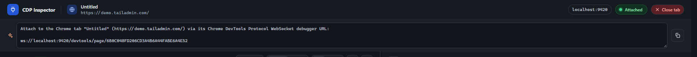

Clicking the attach button opens the inspector panel (`attach.html`) as a new tab, connected directly to the target tab's CDP WebSocket. The header shows the connected tab's title and URL, the debugging port, and a live attached/disconnected status. Below it, a ready-to-paste prompt points an AI coding agent at this exact tab's CDP endpoint for automated debugging - the starting point for every use case in [AI & automation use cases](/workflows/ai-and-automation/).

<figure class="doc-screenshot">

<figcaption>Panel header: connected tab info, port, status - plus a copyable AI-agent prompt pointed at this tab's CDP endpoint.</figcaption>
</figure>

Below the header, the panel splits into two halves: a live **screencast** of the page on the left, and three tabs - **Message**, **Presets**, and **Network** - on the right.

## Resizing the split

Drag the thin handle between the two halves to resize (clamped between 28%–72%); with it focused, `←`/`→` nudge the split in 2% steps. Below roughly 900px of window width, the handle disappears and the layout stacks into a single column instead.
