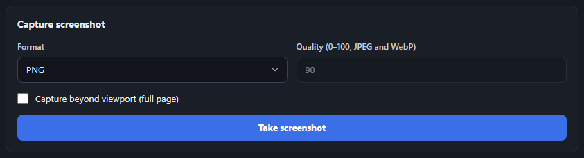
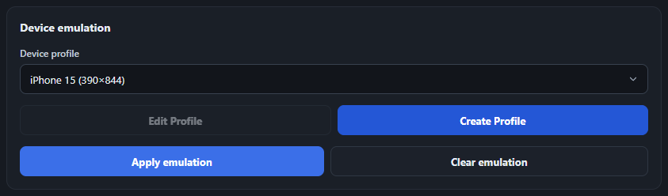
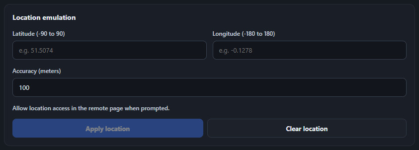
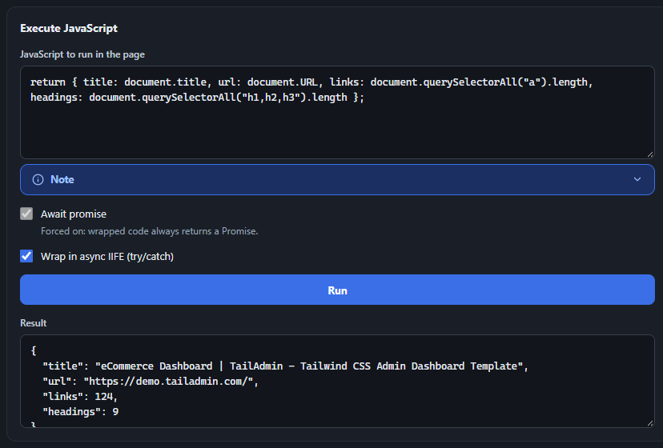

Presets wrap common CDP command sequences into one-click actions, so you don't have to hand-write the method and params yourself.

For custom HTTP headers, open the **Network** tab and follow the [custom headers guide](/inspector/network/#custom-headers).

## Capture screenshot

Grab a PNG, JPEG, or WebP screenshot of the current page, optionally capturing the full scrollable page rather than just the viewport.

<figure class="doc-screenshot">

<figcaption>Screenshot capture - format, quality (for JPEG/WebP), and full-page option.</figcaption>
</figure>

## Device emulation

Switch between built-in device profiles (iPhone, iPad, Pixel, Desktop) or create and save your own custom profiles. See [Device profiles](/inspector/device-profiles/) below for the full create/edit flow.

<figure class="doc-screenshot">

<figcaption>Device emulation - pick a profile, then Apply or Clear.</figcaption>
</figure>

## Location emulation

Override the page's geolocation with a specific latitude, longitude, and accuracy via `Emulation.setGeolocationOverride` - useful for testing location-aware features without physically moving. Fields are validated as you type (lat −90..90, long −180..180, accuracy ≥0), but the red error state only appears after you've started editing, not on a freshly-opened blank form. **Clear location** is always available once connected - it sends `Emulation.clearGeolocationOverride()` to make the page fall back to real/normal geolocation behavior, without resetting the fields you'd typed.

<figure class="doc-screenshot">

<figcaption>Location emulation. The remote page must still accept the geolocation permission prompt.</figcaption>
</figure>

## Execute JavaScript

Run arbitrary code on the attached page via `Runtime.evaluate` and see the return value (or a thrown error) in the Result box.

-   **"Wrap in async IIFE (try/catch)"** (checked by default) wraps your code in an async function with its own try/catch, so a plain `return` statement works (e.g. `return document.title;`). A thrown error is logged to the page's own console *and* shown in the Result box. Return values are JSON-serialized: strings, booleans, finite numbers, plain objects/arrays (including nested), and DOM elements (shown as tag + attributes) come through; anything else - functions, `Map`/`Set`, `NodeList`, `NaN`/`Infinity` - comes back as the literal string `"unparsable object"`.
-   **"Await promise"** is force-checked and disabled whenever the IIFE wrap is on (since the wrapper always returns a Promise). Uncheck the wrap option to make Await a free toggle again - in that mode your code must be a bare expression, not a `return` statement, and the result uses CDP's own formatting instead of the custom serializer.

<figure class="doc-screenshot">

<figcaption>Execute JavaScript - querying the live page's title, URL, and element counts, with the JSON result shown below.</figcaption>
</figure>
