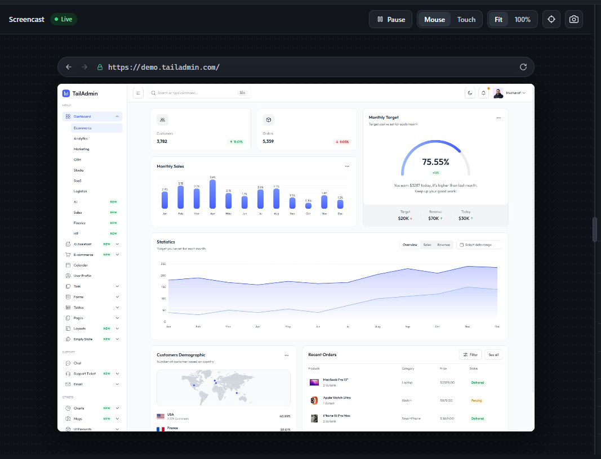

The screencast streams the target page live via `Page.startScreencast`. It's fully interactive, not just a view - clicks, drags, scrolls, and keystrokes are translated into real CDP input events and dispatched to the remote page:

-   **Pause / Live** - stop and resume the frame stream.
-   **Mouse / Touch** - choose which input events clicks and drags on the screencast dispatch to the remote page. Touch mode simulates a single synthetic touch point.
-   **Fit / 100%** - scale the screencast to fit the pane or show it at native resolution (coordinate mapping adjusts accordingly, including scroll offset in 100% mode).
-   **Address bar** - navigate the remote page directly, with back/forward/refresh wired to its real navigation history (not just browser-local history).
-   **Coordinates readout** (crosshair icon) - toggles a live "x: \_ y: \_ · eventType" display of the last input event sent.
-   **Screenshot button** (camera icon) - saves the current frame as a JPEG.

A few details worth knowing: **keyboard input is forwarded only while your mouse is hovering** the screencast (not on click-to-focus) - a green ring appears around the frame while it's capturing keystrokes. Right-clicking sends a real right-click to the page instead of opening your browser's own context menu. Native `<select>` dropdowns are specially handled: since OS-native popups can't be screen-captured, clicking one opens a custom-rendered replica of its options positioned over the real element, and your selection is written back into the actual page.

<figure class="doc-screenshot">

<figcaption>Live screencast of a real page (TailAdmin's dashboard demo) - fully interactive, not a static view.</figcaption>
</figure>
