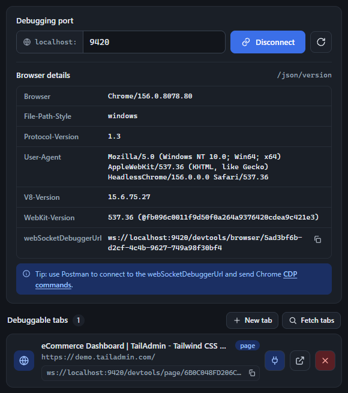

Once the generated (or your own) Chrome instance is running, enter its debugging port and click **Connect**. The popup polls `/json/version` on that port and shows the browser's details - version, user agent, and its own `webSocketDebuggerUrl` for the browser-level CDP endpoint. Click **Fetch tabs** to (re-)list every debuggable page or iframe currently open in that instance - other target types (service workers, extension background pages, etc.) are filtered out.

-   The **port field** remembers your last 5 distinct ports and offers them as an autocomplete dropdown - click into the field to see them, or start typing to filter. Arrow keys move the highlight, Enter selects the highlighted port (or connects, if nothing's highlighted), Escape closes the list.
-   **Ctrl+R** (Cmd+R on Mac) anywhere in the popup re-runs the connect flow for whatever port is currently set - a quick "reconnect" shortcut, same as the circular-arrow button next to Connect.
-   While connected, the popup **health-checks** the port every 5 seconds in the background. If the remote instance becomes unreachable, the status flips to "Disconnected" and the New-tab button hides - but the tab list and connection aren't automatically torn down; only an explicit Disconnect click resets everything.
-   If you had an active connection the last time you closed the popup, it's restored automatically - opening the popup silently re-attempts `connect()` on launch.

Each tab card shows its title, URL, type (`page`/`iframe`), and CDP WebSocket URL (with its own copy button), plus three action buttons - see [Tab card actions](/popup/tab-actions/) below.

<figure class="doc-screenshot">

<figcaption>Debugging port connection, browser details, and the live tab list once connected.</figcaption>
</figure>
