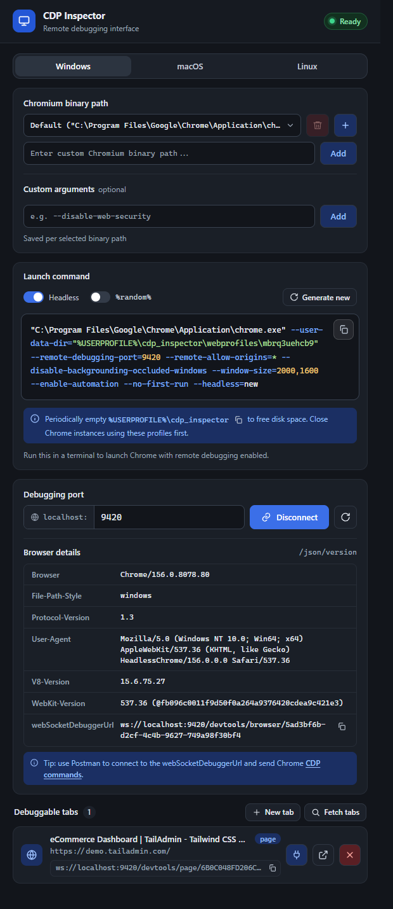

The popup builds the Chrome command line for you - picking a random debugging port (9000–9999) and an isolated profile directory so it never collides with your everyday browser session. It detects your OS automatically via `navigator.platform`, but you can switch between Windows, macOS, and Linux manually with the segmented control at the top; each OS remembers its own binary path and custom-argument choices independently.

-   **Headless** (on by default) - appends `--headless=new`, so the launched Chrome has no visible window.
-   **%random%** - when on, the profile directory uses the shell's own random-value syntax (`%random%` on Windows, `$RANDOM` on macOS/Linux) instead of a value generated once by the extension, so re-running the exact same copied command in a loop gets a fresh profile dir each time.
-   **Generate new** - rolls a fresh random port and profile ID immediately.
-   The copy button copies the command to your clipboard with a checkmark confirmation; a small banner below reminds you to periodically clear out `cdp_inspector/webprofiles` to free disk space.

<figure class="doc-screenshot">

<figcaption>The popup end to end: command generator, an active connection on port 9420, browser details, and one debuggable tab (a TailAdmin dashboard demo).</figcaption>
</figure>
