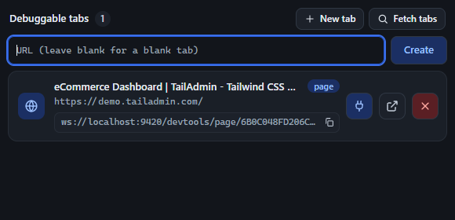
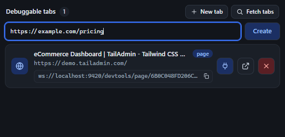

The **New tab** button (next to Fetch tabs, only visible once connected) opens an inline form with a single URL field and a **Create** button - no separate dialog, no page reload.

-   **Leave the field blank** and click Create (or press Enter) to open a blank tab (`about:blank`) in the remote instance.
-   **Type a URL** and the same button opens that page instead. You don't need to type the scheme - if you leave it off, `https://` is prepended automatically (so typing `example.com/pricing` opens `https://example.com/pricing`).
-   On success, the form closes and the tab list refreshes immediately, so the new tab appears in **Debuggable tabs** ready to attach to.
-   If tab creation fails (bad port, extension error, etc.), an inline error message appears under the field instead of a popup alert.

<figure class="doc-screenshot">

<figcaption>Blank tab - leave the URL field empty.</figcaption>
</figure>

<figure class="doc-screenshot">

<figcaption>Tab with a URL - scheme is added automatically if you omit it.</figcaption>
</figure>
